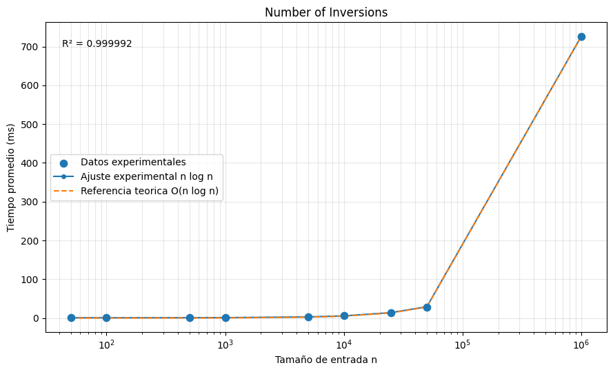
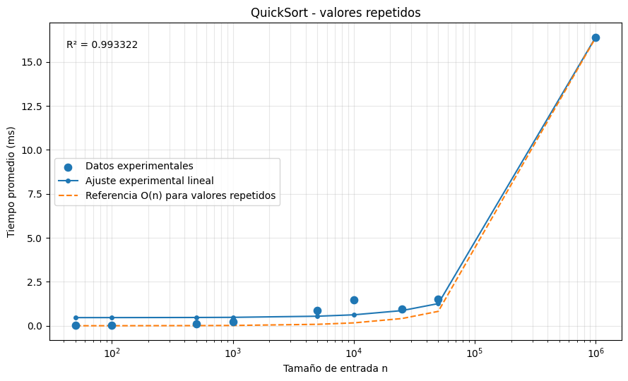
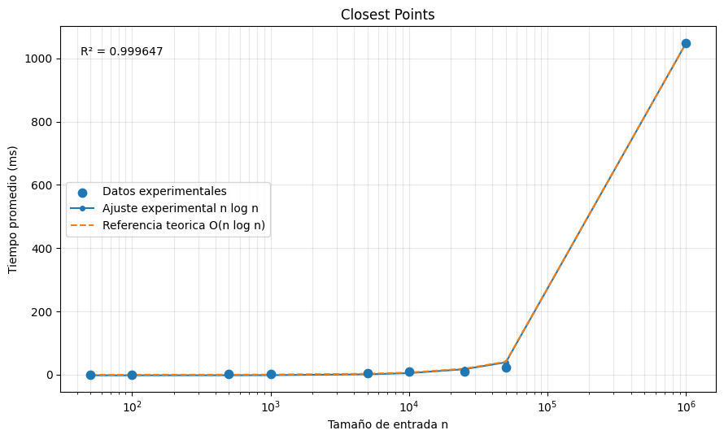
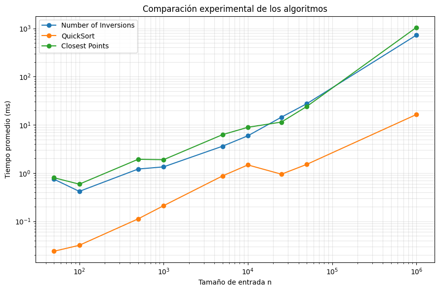
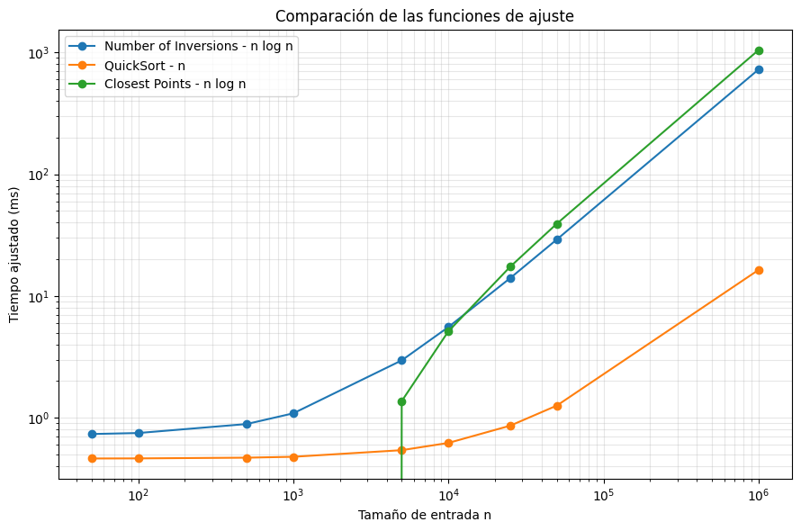

# Análisis experimental

## 1. Entorno de ejecución

Las pruebas de rendimiento se realizaron en la misma máquina con el fin
de mantener un entorno de ejecución consistente.

- Procesador: 12th Gen Intel(R) Core(TM) i5-1235U
- Memoria RAM: 16 GB
- Sistema operativo: Microsoft Windows 11 Pro
- Arquitectura: 64 bits
- Versión del sistema operativo: 10.0.26200

Durante las mediciones se buscó mantener las mismas condiciones de
ejecución y evitar otras aplicaciones de alto consumo que pudieran
afectar los tiempos registrados.

---

## 2. Metodología

La métrica utilizada para la experimentación fue el tiempo de ejecución
en milisegundos.

Para cada algoritmo y cada tamaño de entrada se siguió el siguiente
procedimiento:

1. Generar la entrada antes de iniciar la medición.
2. Ejecutar el algoritmo 10 veces con la misma entrada.
3. Registrar el tiempo de cada ejecución.
4. Descartar el tiempo de la primera ejecución.
5. Calcular el promedio de las 9 ejecuciones restantes.

La generación de los datos no se incluyó dentro del tiempo medido, de
modo que el resultado correspondiera únicamente a la ejecución del
algoritmo.

---

## 3. Tamaños de entrada

Las entradas se organizaron según las categorías definidas en el
enunciado de la tarea:

- Toy: `n < 100`
- Small: `100 <= n < 10000`
- Medium: `10000 <= n < 100000`
- Large: `n >= 1000000`

Los tamaños utilizados fueron:

| Categoría | Tamaños utilizados |
| --- | --- |
| Toy | 50 |
| Small | 100, 500, 1000, 5000 |
| Medium | 10000, 25000, 50000 |
| Large | 1000000 |

---

## 4. Escenarios de entrada

Para cada algoritmo se utilizó un escenario de entrada relacionado con
el objetivo del problema.

### 4.1 Number of Inversions

Se utilizaron listas en orden descendente.

Este tipo de entrada contiene una gran cantidad de inversiones y permite
evaluar el algoritmo sobre un caso exigente para el conteo de
inversiones.

### 4.2 Improving QuickSort

Se utilizaron listas con valores repetidos.

Este escenario se relaciona directamente con el objetivo del problema,
ya que la partición de tres vías separa los valores en elementos menores,
iguales y mayores al pivote, mejorando especialmente el comportamiento
cuando existen muchos elementos iguales.

### 4.3 Closest Points

Se utilizaron puntos generados de forma determinística.

Cada punto se representó como:

`(x, 2x)`

Por ejemplo:

`(0, 0), (1, 2), (2, 4), ...`

La generación determinística permitió utilizar exactamente la misma
entrada en las diferentes repeticiones de cada tamaño.

---

## 5. Resultados

Para cada tamaño se realizaron 10 ejecuciones. La primera medición fue
descartada y el promedio se calculó utilizando las 9 ejecuciones
restantes.

### 5.1 Number of Inversions

| Tamaño n | Tiempo promedio (ms) |
| ---: | ---: |
| 50 | 0.7469 |
| 100 | 0.4170 |
| 500 | 1.2127 |
| 1000 | 1.3437 |
| 5000 | 3.5983 |
| 10000 | 5.9238 |
| 25000 | 14.4079 |
| 50000 | 27.4339 |
| 1000000 | 726.2274 |

### 5.2 Improving QuickSort

| Tamaño n | Tiempo promedio (ms) |
| ---: | ---: |
| 50 | 0.0239 |
| 100 | 0.0318 |
| 500 | 0.1124 |
| 1000 | 0.2104 |
| 5000 | 0.8718 |
| 10000 | 1.4744 |
| 25000 | 0.9473 |
| 50000 | 1.5147 |
| 1000000 | 16.3821 |

### 5.3 Closest Points

| Tamaño n | Tiempo promedio (ms) |
| ---: | ---: |
| 50 | 0.8008 |
| 100 | 0.5888 |
| 500 | 1.9318 |
| 1000 | 1.8929 |
| 5000 | 6.2502 |
| 10000 | 8.8954 |
| 25000 | 11.4079 |
| 50000 | 24.0538 |
| 1000000 | 1048.9111 |

---

## 6. Complejidad experimental y teórica

Para determinar qué función representa mejor el comportamiento de los
datos experimentales se compararon tres posibles modelos:

- Lineal: `n`
- Lineal-logarítmico: `n log n`
- Cuadrático: `n²`

La comparación se realizó mediante el coeficiente de determinación `R²`.
Un valor de `R²` más cercano a 1 representa un mejor ajuste de los datos.

### 6.1 Number of Inversions

Los valores obtenidos fueron:

| Modelo | R² |
| --- | ---: |
| n | 0.999824 |
| n log n | 0.999992 |
| n² | 0.998794 |

El mejor ajuste experimental fue `n log n`.

La función obtenida fue:

`T(n) = 3.6397 × 10^-5 (n log2(n)) + 0.7257`

con:

`R² = 0.999992`

La complejidad teórica obtenida mediante la recurrencia del algoritmo es:

`Θ(n log n)`

Por lo tanto, el comportamiento experimental coincide con el crecimiento
esperado según el análisis teórico.

---

### 6.2 Improving QuickSort

Los valores obtenidos fueron:

| Modelo | R² |
| --- | ---: |
| n | 0.993322 |
| n log n | 0.992265 |
| n² | 0.987680 |

El mejor ajuste experimental fue el modelo lineal.

La función obtenida fue:

`T(n) = 1.5944 × 10^-5 n + 0.4626`

con:

`R² = 0.993322`

Este comportamiento se relaciona directamente con el escenario
experimental utilizado, en el cual todos los elementos tenían el mismo
valor.

La partición de tres vías agrupa los elementos iguales al pivote en la
partición `equal`. En este escenario prácticamente todos los elementos
son procesados durante una sola partición y las listas `less` y `greater`
quedan vacías.

Por esta razón, para este tipo particular de entrada se observa un
comportamiento cercano a:

`O(n)`

Esto no significa que QuickSort tenga complejidad lineal para cualquier
entrada. En general, su comportamiento depende de la distribución de los
datos y de las particiones obtenidas. El escenario utilizado permite
observar específicamente la mejora buscada por la partición de tres vías.

---

### 6.3 Closest Points

Los valores obtenidos fueron:

| Modelo | R² |
| --- | ---: |
| n | 0.999129 |
| n log n | 0.999647 |
| n² | 0.999631 |

El mejor ajuste experimental fue `n log n`.

La función obtenida fue:

`T(n) = 5.2686 × 10^-5 (n log2(n)) - 1.8661`

con:

`R² = 0.999647`

El término independiente negativo pertenece únicamente al ajuste
matemático obtenido y no representa un tiempo de ejecución negativo.

La complejidad teórica del algoritmo es:

`O(n log n)`

La recurrencia correspondiente es:

`T(n) = 2T(n/2) + O(n)`

El algoritmo divide el conjunto de puntos en dos partes, resuelve
recursivamente ambas mitades y mantiene el paso de combinación en tiempo
lineal.

Por lo tanto, el ajuste experimental es consistente con el crecimiento
teórico esperado.

---

## 7. Comparación de los algoritmos

### 7.1 Comparación de los tiempos experimentales

La siguiente gráfica presenta los tiempos promedio obtenidos para los
tres algoritmos.

Se utilizaron escalas logarítmicas para facilitar la visualización,
debido a las diferencias entre los tamaños de entrada y los tiempos
registrados.

Para `n = 1000000` se obtuvieron los siguientes tiempos promedio:

| Algoritmo | Tiempo promedio (ms) |
| --- | ---: |
| Number of Inversions | 726.2274 |
| Improving QuickSort | 16.3821 |
| Closest Points | 1048.9111 |

Dentro de los escenarios utilizados, QuickSort presentó los menores
tiempos de ejecución.

Number of Inversions y Closest Points presentaron tiempos mayores y un
crecimiento consistente con sus ajustes de tipo `n log n`.

Sin embargo, estos valores no deben interpretarse como una comparación
directa de eficiencia entre problemas equivalentes, ya que cada
algoritmo resuelve un problema diferente y utiliza un escenario de
entrada distinto.

---

### 7.2 Comparación de las funciones de ajuste

Además de comparar los tiempos experimentales, se compararon
gráficamente las funciones que mejor se ajustaron a los datos de cada
algoritmo.

Las funciones obtenidas fueron:

**Number of Inversions**

`T(n) = 3.6397 × 10^-5 (n log2(n)) + 0.7257`

**Improving QuickSort**

`T(n) = 1.5944 × 10^-5 n + 0.4626`

**Closest Points**

`T(n) = 5.2686 × 10^-5 (n log2(n)) - 1.8661`

La comparación se presenta en la siguiente gráfica:

Se observa que Number of Inversions y Closest Points presentan
funciones de crecimiento de tipo `n log n`, mientras que QuickSort,
para el escenario de valores repetidos utilizado, presenta un
comportamiento experimental aproximadamente lineal.

Esta diferencia se relaciona con la partición de tres vías de QuickSort,
que agrupa los elementos iguales al pivote y reduce el trabajo recursivo
cuando existen muchos valores repetidos.
---

## 8. Análisis de resultados

### 8.1 Patrón entre tamaño de entrada y tiempo

En términos generales, al aumentar el tamaño de entrada también aumentó
el tiempo de ejecución de los tres algoritmos.

En Number of Inversions y Closest Points el crecimiento fue más evidente
para los tamaños grandes y presentó un comportamiento consistente con
`n log n`.

QuickSort presentó tiempos considerablemente menores debido al escenario
de valores repetidos utilizado.

En algunos tamaños pequeños y medianos se presentaron variaciones en las
que una entrada más grande obtuvo un tiempo promedio menor que una entrada
más pequeña.

Por ejemplo, para QuickSort:

- `n = 10000`: 1.4744 ms
- `n = 25000`: 0.9473 ms

Estas variaciones no implican que la complejidad del algoritmo disminuya,
sino que forman parte del comportamiento normal de una medición
experimental.

---

### 8.2 Relación observada

Para Number of Inversions, el modelo con mayor `R²` fue:

`n log n`

con:

`R² = 0.999992`

Para Closest Points también fue:

`n log n`

con:

`R² = 0.999647`

Para QuickSort, bajo el escenario de valores repetidos, el mejor ajuste
fue:

`n`

con:

`R² = 0.993322`

Por lo tanto, los datos obtenidos permiten observar dos tipos principales
de crecimiento experimental: lineal y lineal-logarítmico.

---

### 8.3 Comparación con la complejidad teórica

Number of Inversions presentó un ajuste `n log n`, coincidiendo con su
complejidad teórica `Θ(n log n)`.

Closest Points también presentó un ajuste `n log n`, consistente con su
complejidad teórica `O(n log n)`.

QuickSort presentó un ajuste lineal para la entrada utilizada. Este
resultado no contradice su análisis general, ya que la experimentación
se realizó específicamente con valores repetidos para observar el efecto
de la partición de tres vías.

---

### 8.4 Comportamientos inusuales

Los datos no presentan un crecimiento perfectamente uniforme.

Esto es especialmente visible en tamaños pequeños, donde el tiempo total
de ejecución es muy reducido y cualquier variación del sistema puede
tener un efecto considerable sobre la medición.

También se presentaron algunos tiempos individuales más altos que los
demás dentro de una misma entrada.

Por esta razón se realizaron varias ejecuciones y se utilizó el promedio
en lugar de depender de una única medición.

---

### 8.5 Posibles fuentes de error

Algunas posibles fuentes de variación en los resultados son:

- procesos del sistema operativo ejecutándose en segundo plano;
- consumo de memoria por otras aplicaciones;
- optimizaciones realizadas por la máquina virtual de Java;
- recolección de basura de la JVM;
- variaciones normales del sistema durante la ejecución;
- precisión de la medición en algoritmos con tiempos muy pequeños.

Para reducir el efecto de estas variables se utilizó la misma máquina
durante toda la experimentación, se realizaron 10 ejecuciones por entrada,
se descartó la primera medición y se calculó el promedio de las 9
mediciones restantes.

---

## 9. Conclusión experimental

Los resultados obtenidos permitieron observar una relación clara entre el
tamaño de las entradas y el tiempo de ejecución de los algoritmos.

Number of Inversions obtuvo como mejor ajuste experimental una función
de tipo `n log n`, coincidiendo con la complejidad teórica obtenida para
MergeSort modificado.

Closest Points también presentó un comportamiento experimental de tipo
`n log n`, consistente con el algoritmo de Divide and Conquer utilizado.

En QuickSort, el escenario de valores repetidos produjo un comportamiento
aproximadamente lineal. Este resultado muestra el beneficio de utilizar
una partición de tres vías cuando existen muchos elementos iguales al
pivote.

La comparación gráfica de las funciones ajustadas permitió observar con
mayor claridad las diferencias entre el crecimiento lineal obtenido por
QuickSort en el escenario utilizado y el crecimiento `n log n` observado
en Number of Inversions y Closest Points.

Las pequeñas irregularidades observadas en los tiempos muestran que las
mediciones experimentales están sujetas a factores externos. Sin embargo,
los valores de `R²` obtenidos y las tendencias generales permiten concluir
que los resultados experimentales son consistentes con el comportamiento
esperado de las implementaciones utilizadas.